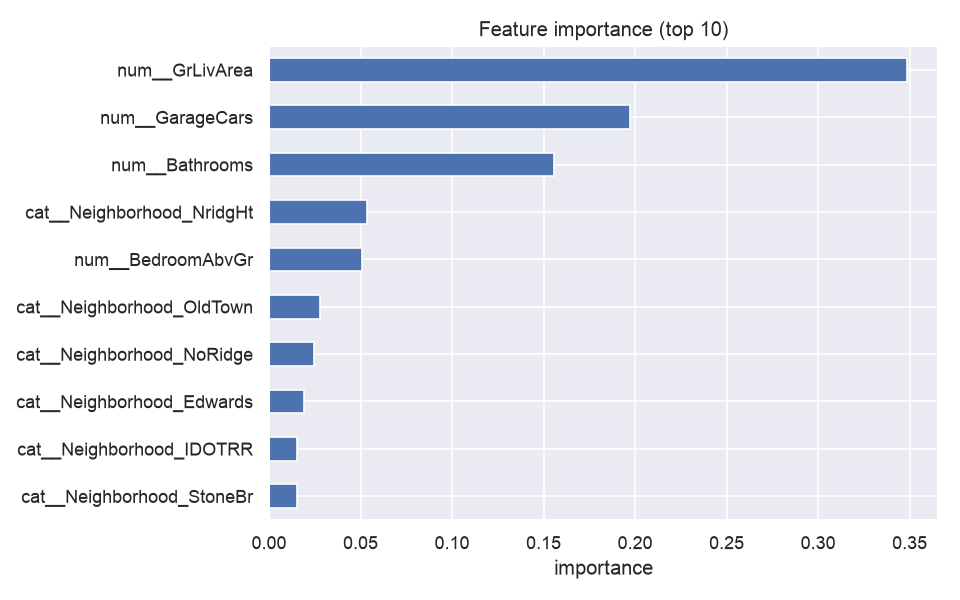
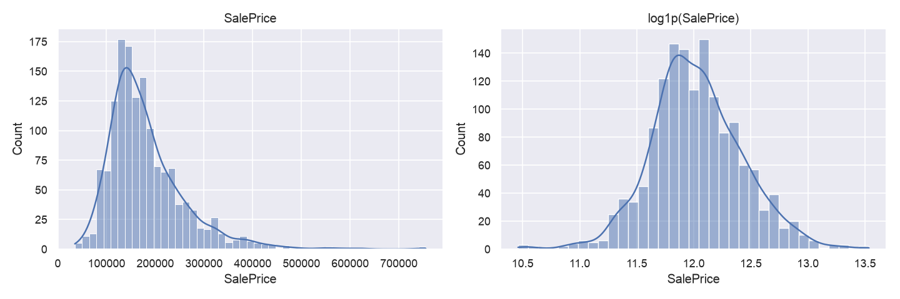
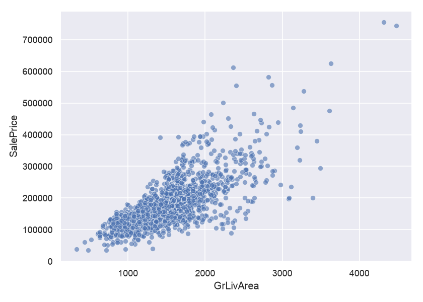

# 🏠 House Price Predictor

Predict house prices (USD) from five simple features using a tuned **Random Forest**,
served through a **Streamlit** web app.



## Problem

Estimate a property's price from the features a buyer actually knows:

| Input | Dataset column |
|-------|----------------|
| 📍 Location | `Neighborhood` |
| 🏠 Size (sqft) | `GrLivArea` |
| 🛏️ Bedrooms | `BedroomAbvGr` |
| 🛁 Bathrooms | `FullBath + 0.5 × HalfBath` *(engineered)* |
| 🚗 Parking | `GarageCars` |

## Dataset

[Ames Housing](https://www.openml.org/d/42165) (the Kaggle *House Prices — Advanced
Regression Techniques* data), loaded programmatically from **OpenML** (`data_id=42165`).

- 1,460 homes · 79 features · target `SalePrice`
- We deliberately model with **only the 5 features above** so the model matches the app 1:1.

## Approach

1. **EDA & cleaning** — study missing values (structural `NA` = "None"), confirm the
   target is right-skewed, spot and remove 2 price anomalies.
2. **Feature engineering** — combine bath columns into a single `Bathrooms`.
3. **Log target** — train on `log1p(SalePrice)` (skew 1.88 → 0.12), invert with `expm1`.
4. **Pipeline** — One-Hot encode `Neighborhood`, pass numeric features through, so the
   preprocessing is stored *with* the model.
5. **Baselines → tuning** — compare 4 models, then `GridSearchCV` the Random Forest.

## Results

Evaluated on a held-out 20% test set (metrics in **USD**, after inverting the log).

| Model | MAE | RMSE | R² |
|-------|-----|------|----|
| Dummy (mean) | $57,012 | $75,775 | -0.04 |
| Linear Regression | $24,769 | $34,799 | 0.781 |
| Gradient Boosting | $24,493 | $33,630 | 0.795 |
| **Random Forest (tuned)** | **$22,826** | **$32,674** | **0.807** |

The tuned cross-validated MAE (`$22,737`) is very close to the test MAE (`$22,826`),
indicating a stable model that generalises.

Most important features: `GrLivArea` (0.35), `GarageCars` (0.20), `Bathrooms` (0.16),
followed by individual neighborhoods.

<p float="left">
  
  
</p>

## Limitations

- Predicts the **US (Ames, Iowa) housing market in USD**, for sales from **2006–2010**.
  It is **not** a predictor of local (non-US) markets — currency is not merely a unit.
- MAE ≈ **$23k**: prediction differences smaller than ~$5k are **not meaningful**.
- Produces **point estimates** only (no prediction interval).

## How to run

```bash
uv sync                              # create env & install deps
uv run python src/fetch_data.py      # download dataset -> data/raw/
uv run python src/train.py           # train + save models/model.joblib
uv run streamlit run app/app.py      # launch the web app
```

## Project structure

```
house-price-predictor/
├── app/app.py               # Streamlit UI
├── data/                    # raw & processed data (git-ignored)
├── models/model.joblib      # saved full pipeline (git-ignored)
├── notebooks/               # EDA and modelling notebooks
├── results/                 # metrics.json + figures
└── src/
    ├── fetch_data.py        # download dataset from OpenML
    ├── data_prep.py         # cleaning + feature engineering
    ├── train.py             # train, tune, evaluate, save model
    ├── predict.py           # inference helpers
    └── make_figures.py      # regenerate README figures
```

## Tech stack

Python 3.12 · [uv](https://github.com/astral-sh/uv) · scikit-learn · pandas · NumPy ·
Matplotlib / seaborn · Streamlit
